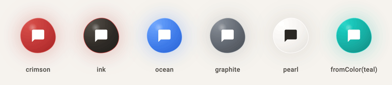
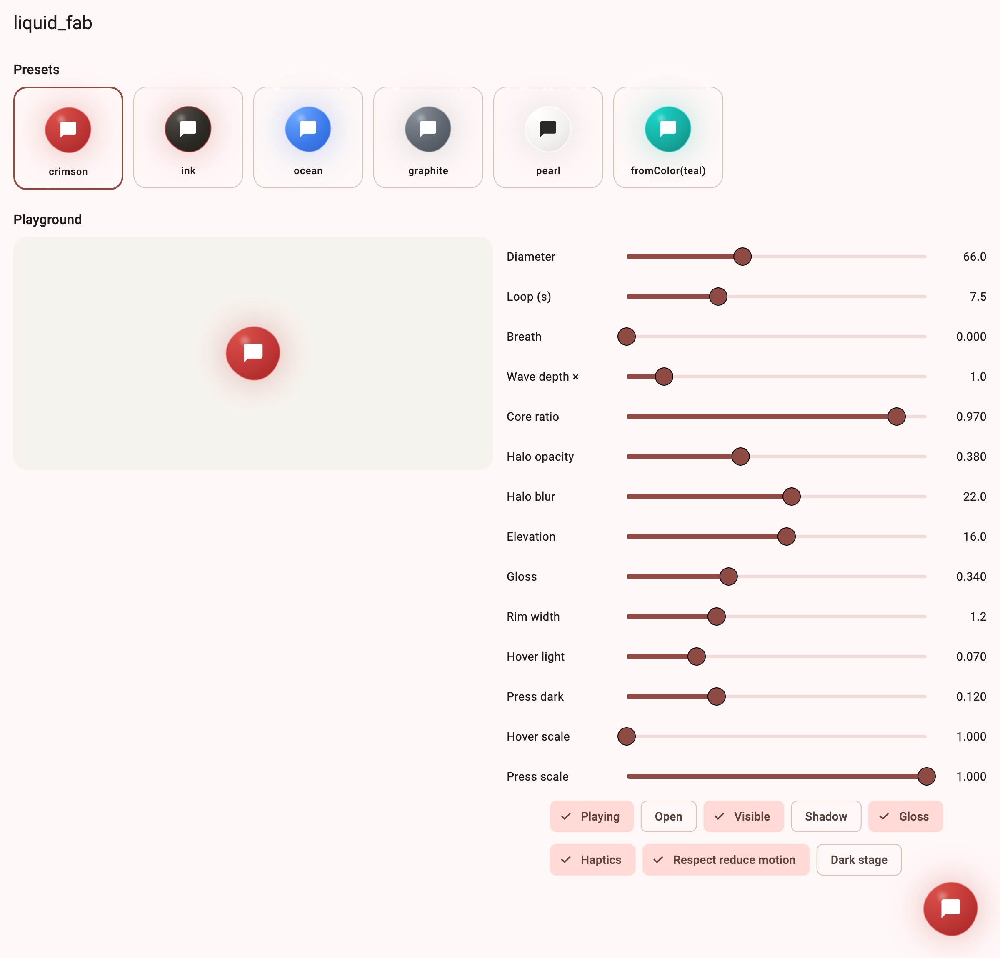

# liquid_fab

A floating action button drawn as a glossy liquid ball. Its edge ripples with
slow travelling waves and it glows; the ball itself never changes size.
Everything about it can be changed: size, motion, wave shape, colours, halo,
hover and press light, gloss, rim, an optional shadow and interaction.

<!-- TODO(media): replace with a recorded GIF of the presets. -->


<!-- TODO(media): replace with a screenshot of the example playground. -->


* Round, but alive: the edge is a circle nudged by a few shallow sine waves.
  Every wave completes a whole number of cycles per loop, so the animation
  never shows a seam. The size stays fixed; an opt-in breath can swell it.
* Layered like a real object: diffused halo, lit radial-gradient surface,
  glossy highlight and an illuminated rim, with an optional drop shadow.
* Behaves like a button: hover brightens the halo and lightens the surface,
  a press darkens it, plus haptics, keyboard activation, semantics, tooltip,
  a fade in and out with `visible`, and an animated swap to a close icon when
  `open`. Hover and press scale are there if you want them.
* Respects reduced motion by default.
* No dependencies beyond Flutter.

## Getting started

```yaml
dependencies:
  liquid_fab: ^0.1.0
```

```dart
import 'package:liquid_fab/liquid_fab.dart';

Scaffold(
  floatingActionButton: LiquidFab(
    style: const LiquidFabStyle.crimson(),
    open: chatOpen,
    semanticLabel: 'Open chat',
    openSemanticLabel: 'Close chat',
    onTap: () => setState(() => chatOpen = !chatOpen),
  ),
);
```

`LiquidFab` takes `diameter + 2 * padding` square (86×86 by default); the
padding leaves room for the ripple, breath and halo. Because of that padding,
pass a negative offset or a custom `FloatingActionButtonLocation` if you want
the ball itself to sit exactly where a standard FAB would.

## Presets

| Preset | Look |
| --- | --- |
| `LiquidFabStyle.crimson()` | Deep crimson `#9B1C1C`, lit to `#BF3636`. |
| `LiquidFabStyle.ink()` | Near-black warm ink `#1A1814` with a crimson glow and rim. |
| `LiquidFabStyle.ocean()` | Clear mid blue. The default. |
| `LiquidFabStyle.graphite()` | Neutral cool grey. |
| `LiquidFabStyle.pearl()` | Light pearl with a dark icon. |
| `LiquidFabStyle.fromColor(color)` | A four-stop ramp, halo and rim derived from one colour. |

Every preset is a plain `LiquidFabStyle`, so tweak it with `copyWith`:

```dart
const LiquidFabStyle.ink().copyWith(haloOpacity: 0.5, rimWidth: 2)
```

## Customising the shape

The edge radius at angle θ and loop phase t is

```text
r(θ, t) = radius × (coreRatio + Σ depth × sin(lobes × θ + speed × t + phase))
```

```dart
LiquidFab(
  style: LiquidFabStyle(
    coreRatio: 0.9,
    waves: const [
      LiquidWave(lobes: 3, depth: 0.04, speed: 2),
      LiquidWave(lobes: 5, depth: 0.02, speed: -3, phase: 1.2),
    ],
  ),
  onTap: () {},
)
```

`speed` is an `int` on purpose: whole cycles per loop keep the loop seamless.
Keep `coreRatio + Σ depth` at or below 1 so the edge stays inside the box.
Depths of around 0.01 already read as liquid on a 66px ball; past 0.05 it
starts to look like a blob.

## Animating the style

Change `style` and the ball animates to it over `styleDuration` (300 ms by
default). Shapes with different waves cross-fade, so the loop stays seamless
mid-transition. For your own animations use `LiquidFabStyle.lerp` or
`LiquidFabStyleTween`.

## Just the drawing

`LiquidFabPainter` paints one frame; drive `progress` (0 to 1) yourself:

```dart
CustomPaint(
  size: const Size.square(82),
  painter: LiquidFabPainter(
    progress: controller.value,
    style: const LiquidFabStyle.pearl(),
    hover: 0,        // 0..1
    pressed: false,
    padding: 10,
  ),
)
```

The opt-in breath is not part of the painting; apply
`Transform.scale(scale: style.breathScaleAt(progress))` if you want it.
`LiquidFabPainter.edgePath` returns the outline on its own.

## `LiquidFab` parameters

| Parameter | Type | Default | Description |
| --- | --- | --- | --- |
| `onTap` | `VoidCallback?` | `null` | Called on tap or keyboard activation. Null disables the button. |
| `open` | `bool` | `false` | Shows `openChild` instead of `child`. |
| `child` | `Widget?` | chat bubble icon | What sits on the ball while closed. Icons and text take `style.iconColor`. |
| `openChild` | `Widget?` | close icon | What sits on the ball while open. |
| `style` | `LiquidFabStyle` | `LiquidFabStyle()` (ocean) | The look. Changes animate. |
| `diameter` | `double` | `66` | Ball diameter. |
| `padding` | `double` | `10` | Room on each side for ripple, breath and halo. |
| `loopDuration` | `Duration` | 7.5 s | One full ripple loop. Shorter is faster. |
| `playing` | `bool` | `true` | False holds the current frame. |
| `respectReduceMotion` | `bool` | `true` | Hold still when the platform asks for reduced motion. |
| `visible` | `bool` | `true` | Fades the button in and out; hidden, it ignores input, focus and semantics and stops its ripple. |
| `visibilityDuration` | `Duration` | 200 ms | Fade duration. |
| `visibilityCurve` | `Curve` | `Curves.easeOut` | Fade curve. |
| `hoverDuration` | `Duration` | 200 ms | How long the hover light takes to come up or die down. |
| `hoverCurve` | `Curve` | `Curves.easeOutCubic` | Hover light curve. |
| `hoverScale` | `double` | `1` | Opt-in scale while hovered or focused. |
| `pressScale` | `double` | `1` | Opt-in scale while pressed. |
| `scaleDuration` | `Duration` | 160 ms | Opt-in hover/press scale duration. |
| `scaleCurve` | `Curve` | `Curves.easeOutCubic` | Opt-in hover/press scale curve. |
| `swapDuration` | `Duration` | 220 ms | `child` ↔ `openChild` swap duration. |
| `swapTransitionBuilder` | `AnimatedSwitcherTransitionBuilder` | `LiquidFab.spinFadeTransition` | The swap transition. |
| `styleDuration` | `Duration` | 300 ms | Style change duration. `Duration.zero` jumps. |
| `styleCurve` | `Curve` | `Curves.easeInOut` | Style change curve. |
| `enableHaptics` | `bool` | `true` | Light haptic tick on tap. |
| `mouseCursor` | `MouseCursor?` | click when enabled | Cursor over the ball. |
| `semanticLabel` | `String?` | `null` | Screen-reader label while closed. Replaces the child's semantics. |
| `openSemanticLabel` | `String?` | `semanticLabel` | Screen-reader label while open. |
| `tooltip` | `String?` | `null` | Tooltip text. |
| `focusNode` | `FocusNode?` | `null` | Focus node for keyboard focus. |
| `autofocus` | `bool` | `false` | Take focus when first built. |

## `LiquidFabStyle` fields

| Field | Type | Default | Description |
| --- | --- | --- | --- |
| `colors` | `List<Color>` | ocean ramp | Surface gradient, lit highlight to shaded edge. At least two. |
| `stops` | `List<double>?` | even | Gradient stops, ascending 0 to 1. |
| `gradientCenter` | `Alignment` | `(-0.35, -0.45)` | Where the light hits. |
| `gradientRadius` | `double` | `1.3` | Radial gradient radius. |
| `coreRatio` | `double` | `0.97` | Resting edge radius as a fraction of the available radius. |
| `waves` | `List<LiquidWave>` | `defaultWaves` (3/4/2 lobes, depths 0.013/0.008/0.0045, speeds +2/−2/+1) | Travelling waves on the edge. Empty for a circle. |
| `pointCount` | `int` | `240` | Points tracing the edge. |
| `breathAmount` | `double` | `0` | Opt-in swell as a fraction of size (`0.025` is ±2.5%). |
| `breathCycles` | `int` | `2` | Breaths per loop. |
| `haloColor` | `Color?` | `colors[1]` | Glow colour. |
| `haloOpacity` | `double` | `0.38` | Glow opacity. `0` turns it off. |
| `haloBlur` | `double` | `22` | Glow blur sigma. |
| `haloHoverBoost` | `double` | `1.35` | Glow opacity multiplier when fully hovered. |
| `hoverOverlayColor` | `Color` | white | Wash over the surface on hover. |
| `hoverOverlayOpacity` | `double` | `0.07` | Hover wash opacity when fully hovered. |
| `pressOverlayColor` | `Color` | black | Wash over the surface while pressed. |
| `pressOverlayOpacity` | `double` | `0.12` | Press wash opacity. |
| `showShadow` | `bool` | `false` | Draw a floating drop shadow. |
| `shadowColor` | `Color?` | second-darkest colour | Shadow colour. |
| `elevation` | `double` | `16` | Shadow elevation at rest. |
| `hoverElevation` | `double` | `16` | Shadow elevation when fully hovered. |
| `showGloss` | `bool` | `true` | Draw the glossy highlight. |
| `glossColor` | `Color` | white | Highlight colour. |
| `glossOpacity` | `double` | `0.34` | Highlight peak opacity. |
| `glossSize` | `Size` | `(0.95, 0.5)` | Highlight oval size, in radii. |
| `glossOffset` | `Offset` | `(-0.3, -0.45)` | Highlight centre offset, in radii. |
| `rimWidth` | `double` | `1.2` | Rim stroke width. `0` turns it off. |
| `rimColor` | `Color?` | lightened `colors.first` | Rim colour. |
| `rimOpacity` | `double` | `0.6` | Rim opacity. |
| `iconColor` | `Color` | white | Default colour for icons and text on the ball. |

## `LiquidWave` fields

| Field | Type | Default | Description |
| --- | --- | --- | --- |
| `lobes` | `int` | required | Bumps around the edge. `0` pulses, `2` ovals, `3`+ reads as liquid. |
| `depth` | `double` | required | Peak displacement as a fraction of the radius (0 to 0.5). |
| `speed` | `int` | `1` | Whole cycles per loop; the sign sets the direction. |
| `phase` | `double` | `0` | Starting phase offset, in radians. |

## Example

[`example/`](example/) has the presets and a playground with sliders for every
major setting:

```bash
cd example
flutter run -d chrome
```

## Licence

BSD 3-Clause. See [LICENSE](LICENSE).
